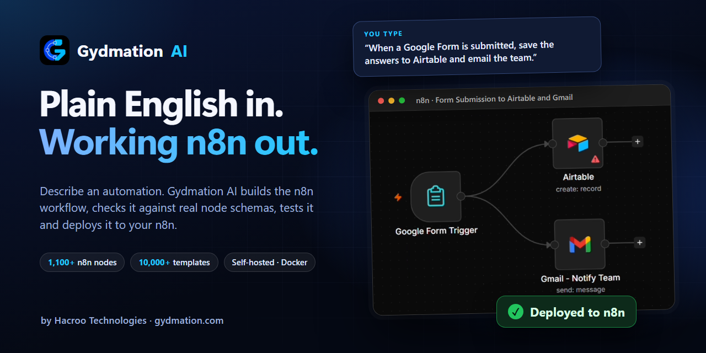
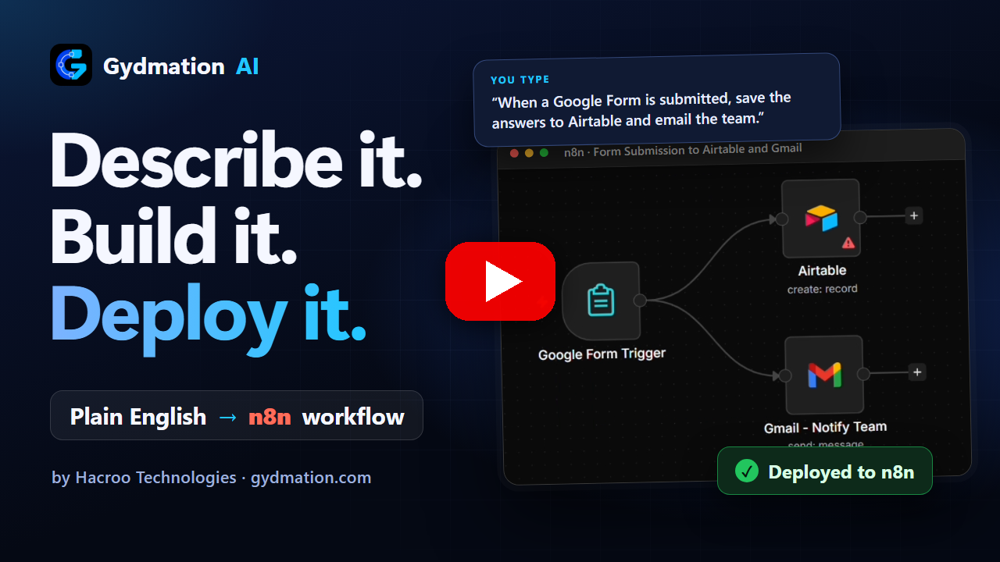
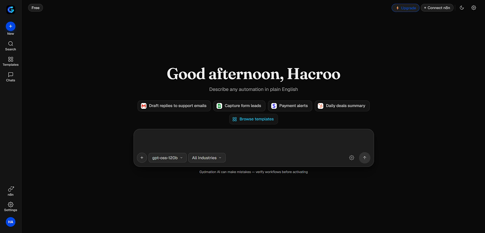
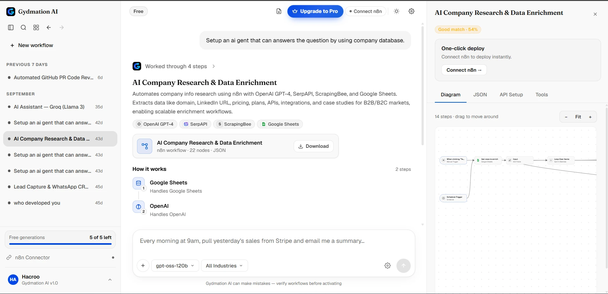
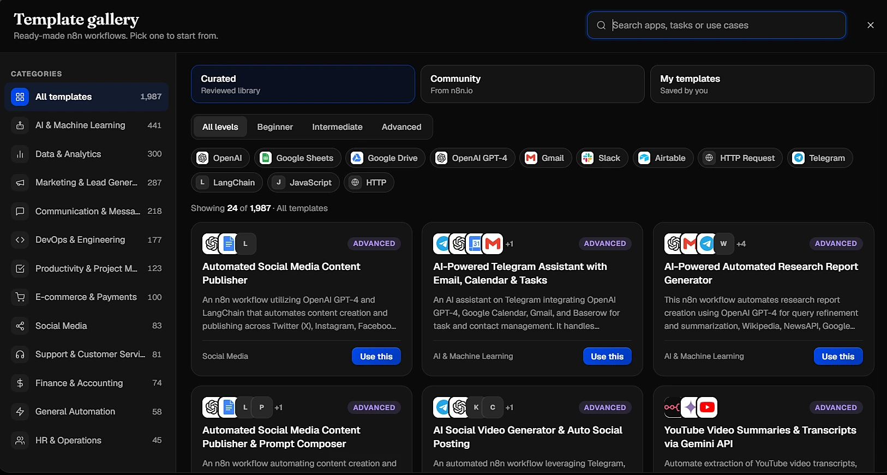
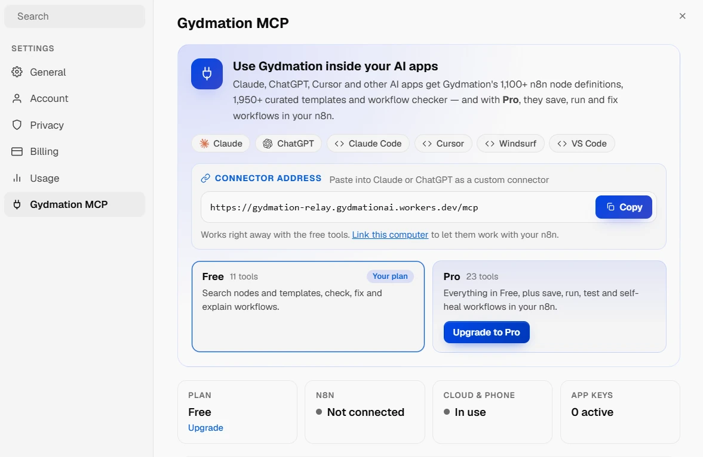
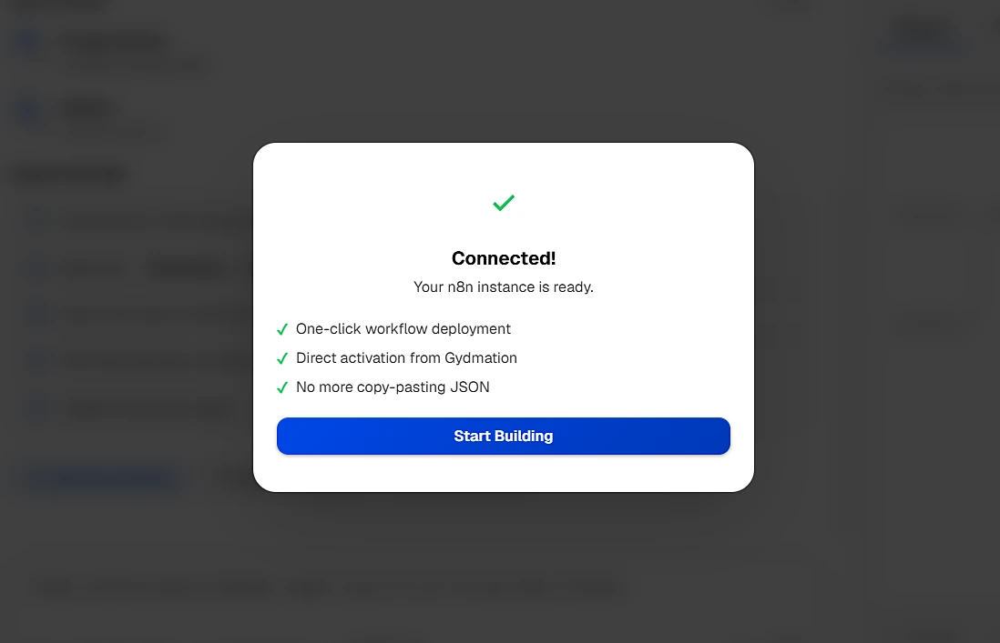
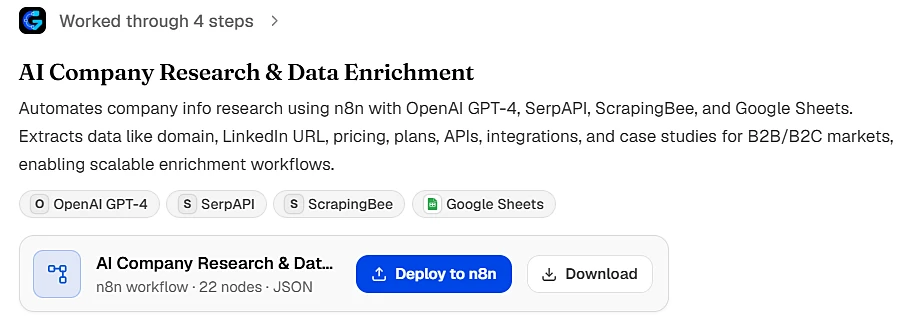
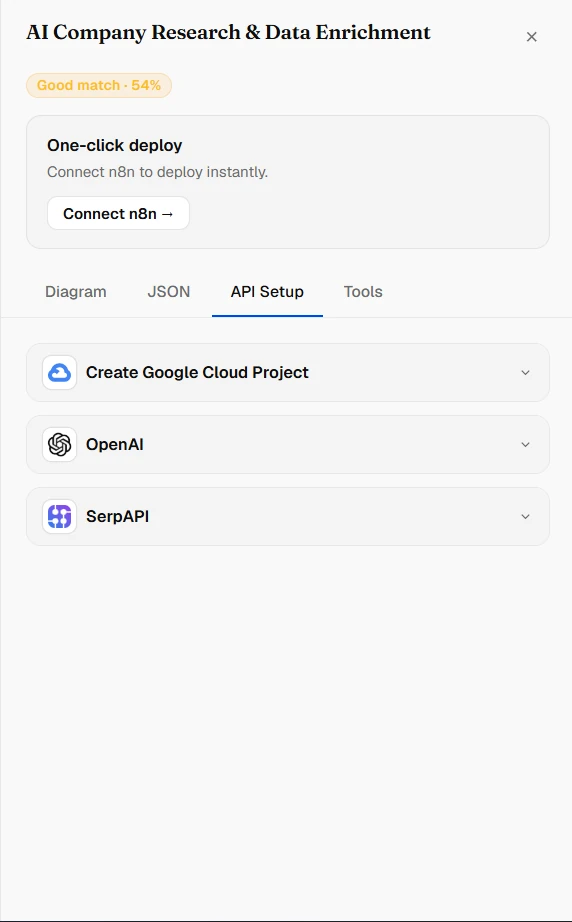
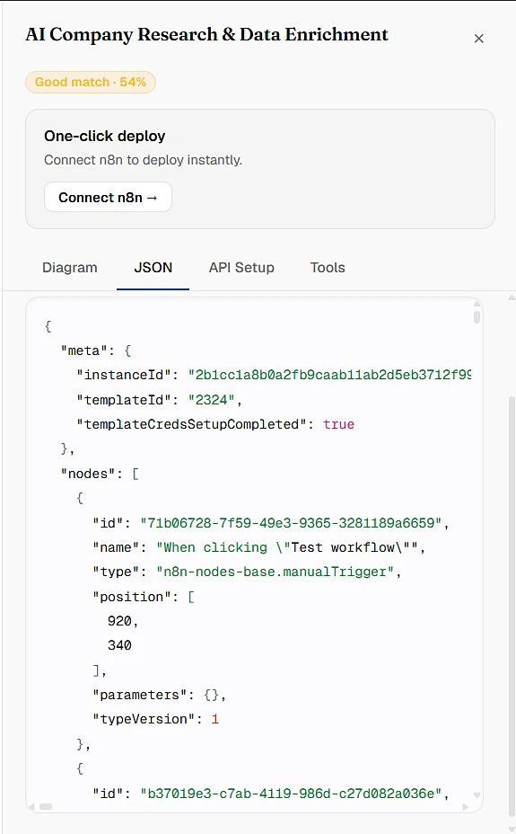

<p align="center">
  <a href="https://gydmation.com"></a>
</p>

<p align="center">
  <b>Describe an automation in plain English. Gydmation AI builds the n8n workflow, checks it, tests it and deploys it to your n8n.</b>
</p>

<p align="center">
  <a href="https://gydmation.com"></a>
  <a href="https://hub.docker.com/r/hacrootechnologies/gydmation-ai"></a>
  
  
  <a href="https://www.youtube.com/watch?v=Qeu42BbZBuQ"></a>
</p>

---

## See it in action

<p align="center">
  <a href="https://www.youtube.com/watch?v=Qeu42BbZBuQ" title="Watch the 2-minute demo on YouTube">
    
  </a>
  <br>
  <sub>▶ <a href="https://www.youtube.com/watch?v=Qeu42BbZBuQ">Watch the 2-minute demo</a>: “When a Google Form is submitted, save the answers to Airtable and email the team” becomes a tested n8n workflow, deployed in one click.</sub>
</p>

## Why Gydmation AI

| Feature | What it means for you |
|---|---|
| 🗣️ **Plain English in** | Describe what you want automated. No node graph, no learning curve. |
| ❓ **Asks before it guesses** | When a detail is missing, it asks a short question instead of guessing. |
| ✅ **Checked, not just generated** | Every node is validated against real n8n node schemas, then the workflow is tested with sample data. |
| 🔑 **Guided credential setup** | Step-by-step setup for every API the workflow needs. Your keys stay in your n8n. |
| 🚀 **One-click deploy** | Connect your n8n (cloud or self-hosted) once, then deploy straight from Gydmation, or download the JSON. |
| 🧩 **Built on real n8n knowledge** | 1,100+ n8n node types and 10,000+ workflow templates to build from. |
| 🤖 **Works inside your AI apps** | Gydmation MCP connects Claude, ChatGPT, Claude Code, Cursor, Windsurf or VS Code. With Pro, they can save, run and fix workflows in your n8n. |
| 🔒 **Self-hosted** | Runs on your machine with Docker. Your prompts, workflows and n8n credentials are stored there, not on our servers. |

## Screenshots

<table>
  <tr>
    <td width="50%"><br><sub><b>Start from a sentence</b> — type what you want automated.</sub></td>
    <td width="50%"><br><sub><b>Describe it, get a working workflow</b> — diagram, JSON, API setup and deploy side by side.</sub></td>
  </tr>
  <tr>
    <td><br><sub><b>10,000+ n8n templates</b> — curated by category, app and level, plus n8n's community library.</sub></td>
    <td><br><sub><b>Gydmation MCP</b> — use it inside Claude, ChatGPT, Claude Code, Cursor, Windsurf or VS Code. With Pro, they save, run and fix workflows in your n8n.</sub></td>
  </tr>
  <tr>
    <td><br><sub><b>Connect your n8n once</b> — then deploy and activate straight from Gydmation.</sub></td>
    <td><br><sub><b>One-click deploy</b> — or download the workflow as JSON.</sub></td>
  </tr>
  <tr>
    <td><br><sub><b>Credential setup, guided</b> — your keys stay in your n8n.</sub></td>
    <td><br><sub><b>Real n8n JSON</b> — ready to import into any n8n.</sub></td>
  </tr>
</table>

## Quick start

**You need:** [Docker Desktop](https://www.docker.com/products/docker-desktop/), installed and running, and about 4 GB of free disk space.

**1. Get the setup file.** Click the green **Code** button above → **Download ZIP** and unzip it. Or download only `docker-compose.yml`:

```bash
# macOS / Linux
curl -O https://raw.githubusercontent.com/hacrootechnologies/Gydmation-AI/main/docker-compose.yml
```

```powershell
# Windows (PowerShell)
Invoke-WebRequest https://raw.githubusercontent.com/hacrootechnologies/Gydmation-AI/main/docker-compose.yml -OutFile docker-compose.yml
```

**2. Start it.** Open a terminal in that folder and run:

```bash
docker compose pull
docker compose up -d
```

**3. Open it** at **http://localhost:8080** and create your account.

> The very first start prepares the template library and takes a few minutes. The app is usable meanwhile. Later starts take about a minute.

## Everyday commands

| What | Command |
|---|---|
| Start | `docker compose up -d` |
| Stop (everything is kept) | `docker compose down` |
| Update to the latest version | `docker compose pull` then `docker compose up -d` |
| See what it is doing | `docker compose logs -f` (Ctrl+C stops watching, not the app) |

Your account, conversations and settings live in the `gydmation-data` Docker volume, so they survive restarts and updates.

<details>
<summary><b>Port 8080 already in use?</b></summary>

Run it on another port, for example 3000:

```bash
# macOS / Linux
GYDMATION_PORT=3000 docker compose up -d
```

```powershell
# Windows (PowerShell)
$env:GYDMATION_PORT=3000; docker compose up -d
```

Then open **http://localhost:3000**. The app only listens on this computer (`127.0.0.1`), not on your Wi-Fi network.
</details>

<details>
<summary><b>Remove Gydmation AI completely</b></summary>

```bash
docker compose down
docker volume rm gydmation-data   # deletes your account data on this machine
```
</details>

## Plans

| | **Free** | **Pro** |
|---|---|---|
| Price | $0 | **$29 / month** (India: ₹1,999 + 18% GST) |
| AI models | Your own API key (BYOK) | Claude Sonnet 5 & Claude Opus 5 — no API key needed |
| Workflows | 5 per month | 1,000 AI credits every month |
| Templates | Full library for your first 5 days, then the top-rated ones | All 10,000+ |
| One-click n8n deploy | ✓ | ✓ |

Pro works on up to 3 computers. Cancel any time: Pro stays on until your paid period ends. Details: [gydmation.com/pricing](https://gydmation.com/pricing).

## Privacy

Gydmation runs on your own machine. Your prompts, workflows and n8n credentials are stored there, not on our servers. To build a workflow, your prompt goes to the AI model you choose: straight from your machine with your own API key, or, on Pro, through our model service to Anthropic, which passes it on without storing it. We keep only your account and, on Pro, your billing status. Full details: [privacy policy](https://gydmation.com/privacy-policy).

## Help

- 📖 Docs: [gydmation.com/docs](https://gydmation.com/docs) · Install guide: [gydmation.com/self-host](https://gydmation.com/self-host)
- ✉️ Support: [support@hacroo.com](mailto:support@hacroo.com)
- 🐞 Something not working? Run `docker compose logs -f` and send us the output — it almost always shows the cause.

## About

Gydmation AI is built by **[Hacroo Technologies](https://hacroo.com)**, an AI Automation and Agentic AI company from Tamil Nadu, India.

Gydmation AI is proprietary software, © 2026 Hacroo Technologies. This repository holds the installation file and documentation; use of the app is covered by the [terms of service](https://gydmation.com/terms). n8n is a trademark of n8n GmbH; Google Forms, Gmail, Airtable and other names are trademarks of their respective owners. Gydmation AI is an independent product and is not affiliated with or endorsed by them.
